# Gemini 4 Argon is already in your $20 plan. Most people are looking in the wrong app.

**AI · Oct 2026 · 13 min read**

On 13 October Google opened [Gemini 4 Argon](https://blog.google/innovation-and-ai/models-and-research/gemini-models/introducing-gemini-4-argon/), its first Gemini 4 model, to the public. The headline that stuck was that Google keeps its coding tools behind the $100 Ultra plan ([Hardware Busters](https://hwbusters.com/news/gemini-4-argon-lands-in-the-gemini-app-for-20-but-google-keeps-its-coding-tools-behind-the-100-ultra-plan/)). That is true. It is also why a lot of people already paying $20 a month haven't tried the model.

Here's the part that got lost. Argon is not Ultra-only. Google's [release notes](https://gemini.google/release-notes/) say it is rolling out globally in the Gemini app for Google AI Pro and Ultra subscribers. If you pay $19.99 a month for Google AI Pro, you can use Argon on gemini.google.com and in the Gemini desktop app on Mac and Windows. What Ultra adds is Argon inside the developer tools: the standalone Antigravity IDE and CLI, AI Studio and Android Studio Canary ([9to5Google](https://9to5google.com/2026/10/13/gemini-app-4-argon/)).

This is the practical version. Where Argon is, plan by plan. The exact steps on the web and in the desktop app. What the Pro limits actually are. And the benchmark numbers that tell you when to pick Argon over the model you already use. I checked every claim against Google's own pages, and where Google hasn't said something, I say so.


*Pro gets the model everywhere a consumer can reach it. Ultra adds the developer tools.*

## The 60-second version

- Plan: Google AI Pro, $19.99 a month in the US, or Ultra from $99.99. Google lists Argon for those two plans only.
- Web: open gemini.google.com with the account that pays for Pro, then pick `4 Argon` from the model drop-down.
- Desktop: install the Gemini app from gemini.google/desktop (macOS 15+ or Windows 10+), summon it with Option + Space or Alt + Space, and pick `4 Argon` the same way.
- Limits: a 1M-token context window, four times the free usage, a window that refills every 5 hours, and a weekly cap. Run dry and you drop to Flash-Lite until it refills.
- Not included: Argon in the Antigravity IDE or CLI, AI Studio or Android Studio Canary. Those need Ultra, or pay-per-token API access.

## Step 1: check you are on a plan that has it

Google sells four consumer plans. The [Gemini app announcement](https://blog.google/innovation-and-ai/products/gemini-app/gemini-4-argon-availability/) names Pro and Ultra as the plans that get Argon. The context windows and usage multipliers come from Google's [Gemini Apps limits page](https://support.google.com/gemini/answer/16275805?hl=en).

*Google AI plans and Gemini 4 Argon, October 2026*

| Plan | US price | Argon in the Gemini app | Context window in the app | Usage vs. Free |
| :--- | :--- | :--- | :--- | :--- |
| Free | $0 | No | 32K tokens | 1x |
| Plus | $4.99/mo | Not listed | 128K tokens | 2x |
| Pro | $19.99/mo | Yes | 1M tokens | 4x |
| Ultra | from $99.99/mo | Yes | 1M tokens | 5x or 20x Pro |

Three things catch people out. You have to be 18 or over ([Google AI plans](https://gemini.google/subscriptions/)). The free student offer is a year of AI Pro in the US only; in 140+ other countries it is a year of AI Plus, which does not list Argon ([release notes, 19 August](https://gemini.google/release-notes/)). And prices are local: from Pakistan, where I'm writing this, the plans page lists Pro at Rs 5,600 a month.

## Step 2: use Argon on the web

- Go to gemini.google.com and sign in with the Google account that holds the Pro subscription. The plan belongs to one account, not to the browser, so if you juggle a work and a personal account, check the avatar first.
- Open the model drop-down. Pro and Ultra subscribers see four models: `3.5 Flash-Lite`, `3.8 Flash`, `3.1 Pro` and `4 Argon` ([9to5Google](https://9to5google.com/2026/10/13/gemini-app-4-argon/), [Chrome Unboxed](https://chromeunboxed.com/google-is-rolling-out-its-flagship-gemini-4-argon-model-to-millions-more-subscribers-today/)).
- Choose `4 Argon` and give it the job. For code, ask for it in Canvas: Pro subscribers can chat with Argon and have it write code there ([Hardware Busters](https://hwbusters.com/news/gemini-4-argon-lands-in-the-gemini-app-for-20-but-google-keeps-its-coding-tools-behind-the-100-ultra-plan/)).
- Check how much you have left under Settings, at the bottom left, then Usage limits ([Gemini Apps Help](https://support.google.com/gemini/answer/16275805?hl=en)).


*The same three steps on gemini.google.com and in the desktop app.*

> **Don't see 4 Argon in the list?:** The rollout is staged, so it does not reach every Pro account at the same moment. Check that you are signed in to the account that pays, reload the page or update the desktop app, and look again later. Google says Pro and Ultra; it does not say every account on day one.

## Step 3: use Argon in the Gemini desktop app

The desktop app is the better daily driver. It sits one key-press away from whatever you are working in, so you stop switching to a browser tab to ask a question. It signs in with the same Google account and reads the same plan as the web.

*The Gemini desktop app*

|  | Mac | Windows |
| :--- | :--- | :--- |
| Download | gemini.google/mac or gemini.google/desktop | gemini.google/desktop |
| Requires | macOS 15 or later | Windows 10 or later |
| Summon it | Option + Space | Alt + Space |
| Out since | 15 April 2026 | 10 September 2026 |
| Worth knowing | Share a window so Gemini sees what you see; hold Fn to dictate into any app; the Antigravity button at the top | Connects to Gmail and Drive; image creation; Deep Research |

- Install the app and sign in with the Pro account.
- Press Option + Space on a Mac or Alt + Space on Windows to bring it up over whatever you are doing.
- Pick `4 Argon` in the model drop-down, exactly as on the web.
- Flip the Chat / Tasks toggle in the main chat window when the job is bigger than a reply. In Tasks, Gemini keeps working across your Google apps while you are away from the computer, and Google says Pro and Ultra subscribers can hand it tasks ([Gemini app blog](https://blog.google/innovation-and-ai/products/gemini-app/gemini-4-argon-availability/)).
- Connect your apps from Customize in the left menu: more than 40 apps and services, on every plan, though most are English-only and US-first ([release notes](https://gemini.google/release-notes/)).

> **The Antigravity button on the Mac:** Since 13 October the Mac app has an Antigravity button at the top. You hand a coding job to an agent, it builds a plan, and you go back to your chat while it works ([release notes](https://gemini.google/release-notes/)). Google has not said which plans include it, and the standalone Antigravity app needs Ultra for Argon. On Pro, click it and see what it offers you. I would not buy a plan on the assumption that it is included.

## The Pro limits, in plain numbers

Google no longer publishes a daily prompt count. Gemini app limits are now based on compute: how complex the prompt is, which model and features you use, and how long the chat has grown ([Gemini Apps Help](https://support.google.com/gemini/answer/16275805?hl=en)). Your allowance refreshes every 5 hours until you reach a weekly limit. Pro gets four times the free allowance; Ultra gets five or twenty times Pro.


*The number that matters most on Pro is the context window: about 30x what Free gets.*

The context window is the number I would care about most. Free reads 32K tokens at once in the app, Plus 128K, Pro and Ultra 1M. That is the difference between pasting one file and pasting a whole service, a contract bundle or a quarter of meeting notes. Argon is also the model built for that size: on GraphWalks between 256K and 1M tokens it scores 84.2%, against 66.8% for Claude Opus 5.5 and 71.8% for GPT-6 Astra ([model card](https://deepmind.google/models/model-cards/gemini-4-argon/)).

- Use `3.8 Flash` for lookups, rewrites and quick questions. Switch to `4 Argon` when the job needs a big context or a long plan. The model is one of the inputs to the limit.
- Start a new chat for a new job. Chat length is another input, so a huge thread you keep reusing costs more on every turn.
- Save Deep Research and video for when you need them. Google rates Deep Research high and video the most expensive of all.
- Look at Settings, Usage limits before a long session, not halfway through it.
- If you run dry, you can carry on with Flash-Lite until the window refills.

## What Pro doesn't get, and what to do instead

*When the $20 plan is not enough*

| You want | On Pro? | Do this instead |
| :--- | :--- | :--- |
| Argon in the standalone Antigravity IDE or CLI | No | AI Ultra, from $99.99/mo |
| Argon in AI Studio or Android Studio Canary | No | AI Ultra, or the paid Gemini API tier |
| Argon in your own scripts, agents or CI | No, the app is not an API | Gemini API: $2 / $10 per 1M tokens to 30 Nov, then $4 / $20 |
| Argon writing and previewing code with you | Yes | Canvas, on the web or in the desktop app |
| Argon in Google Search | Yes | AI Mode |



*The launch price is half of Opus 5.5. From 1 December it is the same.*

If you do move to the API, read the bill per task rather than per token. Artificial Analysis found that Argon's lower cost comes from cheaper tokens, not fewer: it averaged about 62K output tokens per task in their index, against about 27K for GPT-6 Astra. At the launch price that still worked out cheaper, $1.99 a task against $3.26. At list price it is about $3.98, roughly 1.2 times Astra ([Artificial Analysis](https://artificialanalysis.ai/articles/gemini-4-argon-google-top-three-labs)). Cached input is 95% off, about $0.10 per 1M tokens during the launch period ([Google Cloud](https://cloud.google.com/blog/products/ai-machine-learning/gemini-4-argon-available-on-google-cloud)).

## Is it worth switching the picker? Read both halves of the table

Google's [model card](https://deepmind.google/models/model-cards/gemini-4-argon/) compares Argon with Claude Opus 5.5, Claude Fable 5.1 and GPT-6 Astra on 19 benchmarks. Argon is top on 13, ties GPT-6 Astra on one (CWE-bench v1, 68%) and trails on five. The five it loses are the useful part, because they tell you when to keep your usual model.



*Argon wins where the job is long and the context is big. It loses on hard, novel problems and in the terminal.*

*All 19 rows of the Gemini 4 Argon model card (vendor-reported)*

| Benchmark | Gemini 4 Argon | Claude Opus 5.5 | Claude Fable 5.1 | GPT-6 Astra | What it measures |
| :--- | :--- | :--- | :--- | :--- | :--- |
| Vals Index | 68.9% | 67.0% | 65.8% | 63.1% | Finance, coding, legal and tax work |
| AutomationBench | 51.3% | 42.5% | 31.4% | 41.4% | Multi-step business automation |
| Vals Finance Agent v2 | 65.4% | 58.6% | 58.9% | 53.5% | Financial research and filings |
| Harvey Legal Agent | 19.6% | 3.8% | 6.7% | 5.4% | Legal research and drafting |
| DeepSWE v1.1 | 77.9% | 74.2% | 67.4% | 74.1% | Long-horizon software engineering |
| FrontierSWE v2 | 55.0% | 62.3% | 56.3% | 65.5% | Hard, novel software problems |
| Vibe Code Bench | 91.9% | 90.3% | 90.3% | 89.6% | End-to-end app and UI generation |
| Terminal-Bench 4.0 | 57.4% | 66.4% | 57.9% | 58.2% | Shell and command-line work |
| PostTrainBench | 45.3% | 49.3% | 40.2% | 44.3% | ML engineering |
| Terminal-Bench Science 0.1 | 57.6% | 63.3% | 52.6% | 68.1% | Scientific work in the terminal |
| LABBench 2 | 88.8% | 73.1% | 68.6% | 85.4% | Lab biology reasoning |
| RiemannBench | 76.0% | 69.6% | 65.6% | 72.0% | Mathematics |
| GraphWalks, up to 128K | 99.7% | 90.6% | 91.4% | 98.7% | Reasoning across a long context |
| GraphWalks, 256K to 1M | 84.2% | 66.8% | 65.0% | 71.8% | Reasoning across a 1M context |
| Agent's Last Exam | 39.5% | 38.2% | n/a | 34.2% | Computer use |
| OSWorld-2.0 (offline subset) | 69.2% | n/a | n/a | 72.6% | Computer use |
| Chartography | 71.6% | 66.3% | 46.2% | 71.0% | Reading charts |
| LVBench | 91.7% | 83.7% | 79.7% | 87.5% | Long video understanding |
| CWE-bench v1 | 68.0% | 67.0% | 58.0% | 68.0% | Patching vulnerabilities |

Independent testing tells the same story with less flattering numbers. On the Artificial Analysis Intelligence Index, Argon at high reasoning scores 53: tied with GPT-6 Astra, one point above GPT-6.1 Sol and 23 points above Gemini 3.1 Pro Preview. Claude Opus 5.5 still leads at 58 ([Artificial Analysis](https://artificialanalysis.ai/articles/gemini-4-argon-google-top-three-labs), [The Next Web](https://thenextweb.com/news/gemini-4-argon-artificial-analysis-gpt-6-astra-hallucination)). Their own Terminal-Bench 4 run puts Argon at 57%, behind Astra at 59%, Opus 5.5 at 60% and Claude Sonnet 5.5 at 64%. The surprise is honesty: on their knowledge test Argon's hallucination rate was 15% against 51% for Astra, though it also got fewer answers right, 50% against 63%.

My read: pick Argon when the job is big and long. A whole repository, a stack of PDFs, an hour of video, a multi-step automation where the plan has to survive dozens of steps. Keep Claude Opus 5.5 or GPT-6 Astra for terminal-heavy agent work and genuinely new problems, where Argon is measurably behind.

> The headline says Ultra. The model picker says Pro.

## Under the hood: why 1M is the number that matters

Most frontier models of the past year could read close to a million tokens but stopped writing at 32K or 64K. That is fine for summarising a PDF. It breaks when an agent has to plan a multi-file refactor, read compiler output and emit the whole patch in one go. In the API, `gemini-4-argon` has a 1,048,576-token window shared by input and output. A normal request writes up to 65,536 tokens; with long decode it can write up to the full 1M ([Gemini API docs](https://ai.google.dev/gemini-api/docs/models/gemini-4-argon)), up from 64K on earlier models ([Google, 30 September](https://blog.google/innovation-and-ai/models-and-research/gemini-models/gemini-4-argon/)).

*Gemini 4 Argon, the spec sheet*

```text
model_id         = "gemini-4-argon"   # sparse mixture-of-experts
inputs           = ["text", "image", "video", "audio", "pdf"]
outputs          = ["text"]
context          = 1_048_576          # input and output combined
max_output       = 65_536             # default request
max_output_long  = 1_048_576          # with long decode
thinking_levels  = ["low", "medium", "high"]
knowledge_cutoff = "2026-03"
```

Google's own examples are worth reading for what they have in common. Every one is a bounded job with a check at the end: a test suite, a profiler, a byte-identical output. That is the kind of work where, as I argued in [AI writes 75% of Google's code](/blog/ai-writes-75-percent-of-the-code/), a model can deliver a real multiple rather than a rounding error.

- Chromium: core webpage handling separated out of a roughly 6-million-line legacy folder in a 40-million-line codebase, across hundreds of files. Months of work done in weeks ([Google](https://blog.google/innovation-and-ai/models-and-research/gemini-models/introducing-gemini-4-argon/)).
- YouTube comments: redundant emoji rendering was nearly 45% of server overhead. Twelve fixes halved the frontend's CPU and cut server latency by 30 ms and client latency by 20 ms ([Antigravity blog](https://antigravity.google/blog/gemini-4-argon-in-google-antigravity/)).
- Google's Agent Development Kit: given the team's `.agents/skills` rulebook and a one-paragraph goal, Argon worked overnight and cut in-memory session prep by 40% in long sessions and cold imports by 21% ([Google](https://blog.google/innovation-and-ai/models-and-research/gemini-models/introducing-gemini-4-argon/)).
- Gemma 4 E2B: a 2.85x end-to-end inference speed-up on an A100 with vLLM, from about 37,900 to over 108,000 tokens a second, with 100% token parity ([Google](https://blog.google/innovation-and-ai/models-and-research/gemini-models/introducing-gemini-4-argon/)).
- libgav1: Argon replaced 32K lines of SIMD code in an existing Rust port of Google's AV1 video decoder. The result runs 2.7x faster than that port, with identical output ([Google, 30 September](https://blog.google/innovation-and-ai/models-and-research/gemini-models/gemini-4-argon/)).
- A bug queue: of 134 open bug reports, Argon closed 97 stale or duplicate ones in under three hours, with commit proof, and sorted the other 37 by owner ([Antigravity blog](https://antigravity.google/blog/gemini-4-argon-in-google-antigravity/)).
- Across Alphabet: more than 100K people use Argon in the internal Antigravity each month. Agentic code rose 35% over four weeks and post-submit rollbacks fell 30% ([Antigravity blog](https://antigravity.google/blog/gemini-4-argon-in-google-antigravity/)).

## Safety, if you let it touch your tools

- Prompt injection: across 15 adaptive attempts, attacks succeeded 0.7% of the time, and Google says Argon leads the Gray Swan indirect prompt injection benchmark ([Google](https://blog.google/innovation-and-ai/models-and-research/gemini-models/introducing-gemini-4-argon/)). This matters the moment you connect Gmail, Drive or 40 other apps.
- Shortcuts: attempts to take shortcuts on coding benchmarks, the kind of thing where an agent weakens a test so it passes, fell to 2%, the lowest of any Gemini model Google has released. A monitor reads the model's reasoning and actions in real time, and Google says it avoided penalising the model's thoughts in training so the reasoning stays honest.
- Over-refusals: unjustified refusals of benign or borderline prompts fell 9.6 points compared with Gemini 3.1 Pro ([model card](https://deepmind.google/models/model-cards/gemini-4-argon/)).

## What I would do this week on Pro

- Open the picker today and give `4 Argon` one real job that needs a big context: a whole service, a long contract, a quarter of meeting notes.
- Install the desktop app. Option + Space beats a browser tab, and the Tasks toggle is where the agent work lives.
- Run the same job on the model you use now and compare the answers, not the benchmarks.
- Watch Settings, Usage limits for a week before you decide you need Ultra.
- Pay for Ultra only if you need Argon inside Antigravity, AI Studio or Android Studio. Use the API only if you are building something, and do your trials before the price doubles on 1 December.

## References

- [Google, Introducing Gemini 4 Argon](https://blog.google/innovation-and-ai/models-and-research/gemini-models/introducing-gemini-4-argon/) — 13 October 2026: availability by plan, API pricing, the Chromium, ADK and Gemma case studies, safety numbers.
- [Google, Gemini 4 Argon announcement](https://blog.google/innovation-and-ai/models-and-research/gemini-models/gemini-4-argon/) — 30 September 2026: Fairwind launch, 1M output tokens up from 64K, libgav1, CWE-bench.
- [Google, Gemini 4 Argon comes to the Gemini app](https://blog.google/innovation-and-ai/products/gemini-app/gemini-4-argon-availability/) — Pro and Ultra in the Gemini app, the Tasks toggle, 40+ connected apps, Antigravity in the macOS app.
- [Gemini Apps release notes](https://gemini.google/release-notes/) — Mac app (15 April), Windows app (10 September), the student offer (19 August), Argon and Customize (13 October).
- [Gemini Apps Help, limits and upgrades for Google AI subscribers](https://support.google.com/gemini/answer/16275805?hl=en) — Compute-based limits, the 5-hour refresh, weekly cap, context window by plan, where to check usage.
- [Google AI plans](https://gemini.google/subscriptions/) — Plan contents, Antigravity limits by plan, the 18+ rule, local prices.
- [Google DeepMind, Gemini 4 Argon model card](https://deepmind.google/models/model-cards/gemini-4-argon/) — Architecture, March 2026 cutoff, the 19-row benchmark table, safety evaluations.
- [Gemini API docs, gemini-4-argon](https://ai.google.dev/gemini-api/docs/models/gemini-4-argon) — Token limits, long decode, modalities, thinking levels.
- [Google Cloud, Gemini 4 Argon on Google Cloud](https://cloud.google.com/blog/products/ai-machine-learning/gemini-4-argon-available-on-google-cloud) — Launch and list pricing, cached input discount.
- [Google Antigravity, Gemini 4 Argon in Antigravity](https://antigravity.google/blog/gemini-4-argon-in-google-antigravity/) — Internal Alphabet usage, YouTube comments, the bug queue, Ultra for the desktop app and CLI.
- [9to5Google, Gemini app rolling out Gemini 4 Argon to AI Pro and AI Ultra](https://9to5google.com/2026/10/13/gemini-app-4-argon/) — The model picker, and what still needs Ultra.
- [Chrome Unboxed, Google is rolling out its flagship Gemini 4 Argon model to millions more subscribers today](https://chromeunboxed.com/google-is-rolling-out-its-flagship-gemini-4-argon-model-to-millions-more-subscribers-today/) — Web and app access for Pro, the Chat and Tasks toggle.
- [Hardware Busters, Gemini 4 Argon lands in the Gemini app for $20, but Google keeps its coding tools behind the $100 Ultra plan](https://hwbusters.com/news/gemini-4-argon-lands-in-the-gemini-app-for-20-but-google-keeps-its-coding-tools-behind-the-100-ultra-plan/) — Canvas on Pro, AI Mode, the Ultra-only developer tools.
- [Artificial Analysis, Gemini 4 Argon](https://artificialanalysis.ai/articles/gemini-4-argon-google-top-three-labs) — Intelligence Index 53, cost and tokens per task, hallucination rate, Terminal-Bench 4.
- [The Next Web, Gemini 4 Argon matches GPT-6 Astra and hallucinates far less in early tests](https://thenextweb.com/news/gemini-4-argon-artificial-analysis-gpt-6-astra-hallucination) — Claude Opus 5.5 at 58 on the index.
- [Trending Topics, Gemini 4 Argon on the Artificial Analysis index](https://www.trendingtopics.eu/gemini-4-artificial-analysis-en/) — GPT-6 Astra API pricing.
- [AI writes 75% of Google's code. Do the arithmetic before you cut the team.](/blog/ai-writes-75-percent-of-the-code/) — Why bounded, verifiable jobs are where models pay off.

## Takeaways

- Gemini 4 Argon is in the $19.99 Google AI Pro plan. You can use it today on gemini.google.com and in the Gemini desktop app for Mac and Windows.
- Ultra, from $99.99, is only needed for Argon inside the developer tools: the standalone Antigravity IDE and CLI, AI Studio and Android Studio Canary.
- On the web or the desktop app it is the same three steps: sign in with the Pro account, pick 4 Argon in the model drop-down, then choose Chat or Tasks.
- Pro gives a 1M-token context window in the app, about 30 times Free, and four times the free usage, refilled every 5 hours up to a weekly cap.
- Argon leads 13 of the 19 benchmarks on its model card, especially long-context and long-horizon work, and trails on hard novel coding and terminal tasks.
- If you move to the API, the launch price of $2 / $10 per 1M tokens doubles on 1 December, to the same price as Claude Opus 5.5.
